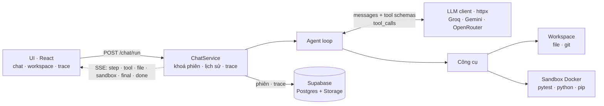

<div align="center">

# Coding Agent

**Agent lập trình tự viết từ đầu: nhận yêu cầu, viết code kèm test, chạy test trong sandbox Docker cô lập, tự sửa đến khi pass rồi commit. Mọi bước đều hiển thị trực tiếp và được lưu thành trace.**


[Vấn đề](#vấn-đề) · [Giải pháp](#giải-pháp) · [Cách hoạt động](#cách-hoạt-động) · [Công nghệ](#công-nghệ-sử-dụng) · [Bắt đầu nhanh](#bắt-đầu-nhanh) · [Tài liệu](#tài-liệu)

</div>

> **Trạng thái:** đang phát triển (v0.1.0, chưa phát hành). Xem [lộ trình](docs/ROADMAP.md).

---

## Vấn đề

Chatbot sinh code thì nhanh, nhưng code đó **chưa từng được chạy**. Người dùng phải tự chép ra, tự chạy, tự dán lỗi ngược lại, và lặp lại nhiều lần. Các agent lập trình tự động giải quyết việc này, nhưng thường kéo theo ba vấn đề khác:

1. **Không an toàn:** code do LLM sinh ra chạy thẳng trên máy thật, có mạng và có quyền ghi khắp nơi.
2. **Hộp đen:** không biết agent đã gửi gì cho model, gọi công cụ nào, tốn bao nhiêu token, và vì sao nó thất bại.
3. **Phụ thuộc framework và nhà cung cấp:** xây trên các framework agent nhiều tầng trừu tượng thì khó kiểm soát payload, retry và ngữ cảnh. Một nhà cung cấp LLM bị giới hạn tốc độ là cả hệ thống dừng.

Ngoài ra, LLM thường viết code dài hơn cần thiết, sửa lan sang phần không được yêu cầu, và báo "xong" khi chưa kiểm chứng.

## Giải pháp

Coding Agent là một **agent duy nhất, tự viết, không dùng framework agent**, chạy trong vòng lặp *gọi LLM → gọi công cụ → nhận kết quả → lặp lại*:

| Vấn đề | Cách giải quyết |
|---|---|
| Code chưa được chạy | Agent tự viết test, chạy `pytest` và đọc lỗi rồi sửa. Chỉ báo `done` khi test đã pass thật. |
| Không an toàn | Mỗi lệnh chạy trong một container Docker riêng: **không mạng**, giới hạn RAM, CPU, số tiến trình và thời gian, chạy bằng user thường. Chỉ lệnh cài thư viện mới có mạng. |
| Hộp đen | Mọi bước được stream lên giao diện qua SSE và lưu thành trace (span cho từng lời gọi LLM, công cụ và lệnh sandbox), kèm token vào/ra của từng bước. |
| Phụ thuộc nhà cung cấp | Client LLM viết bằng `httpx`, gọi nhiều nhà cung cấp tương thích OpenAI. Gọi theo vòng tròn: nhà nào trả lỗi (HTTP khác 200, ví dụ 429 hay 5xx) thì chuyển ngay sang nhà kế tiếp, hết vòng quay lại từ đầu; model trả lời chậm vẫn được chờ. |
| LLM làm ẩu | System prompt gồm [bộ quy tắc riêng và tích hợp nguyên tắc lập trình của Andrej Karpathy](#nguyên-tắc-hành-vi-của-agent), cộng thêm các chốt chặn ở code: không cho ghi đè file chưa đọc, code Python phải qua `ruff check` mới được ghi, dừng khi lỗi lặp lại. |

## Tính năng

- **Viết, chạy và tự sửa:** agent đọc dự án, viết code và test, chạy trong sandbox, đọc log lỗi rồi sửa; xong thì tự `git commit` vào workspace của phiên.
- **Lệnh `/` và đính kèm `@`:** gõ `/test`, `/fix`, `/review`, `/explain`... để chọn kiểu việc; gõ `@file.py` để đính kèm nội dung file.
- **Hỏi lại khi cần:** gặp quyết định cốt lõi không tự suy ra được, agent đặt câu hỏi trắc nghiệm và chờ người dùng trả lời.
- **Workspace trực quan:** cây file với code mở ngay bên dưới (sửa được và lưu bằng ⌘S); lịch sử commit kèm diff; terminal hiện từng lệnh agent đã chạy và cho phép tự gõ lệnh trong sandbox.
- **Trace Explorer:** xem từng phiên theo dòng thời gian, mỗi bước LLM lồng các công cụ và lệnh sandbox của bước đó; có dạng cây và dạng waterfall; xem được cả lượt đang chạy.
- **Chạy nền khi chuyển trang:** lượt đang chạy vẫn tiếp tục khi chuyển sang phiên khác; quay lại vẫn thấy đầy đủ.
- **Tiết kiệm token:** rút gọn kết quả công cụ cũ, giới hạn kích thước request và chỉ gửi schema của nhóm công cụ được bật. Có công cụ mô phỏng để đo token từng bước (xem [Kiểm thử và mô phỏng](#kiểm-thử-và-mô-phỏng)).

## Cách hoạt động



**Một lượt chat:**

1. **Dựng brief:** gồm yêu cầu, chỉ dẫn của lệnh `/` (nếu có), nội dung file `@` đính kèm, lịch sử gần nhất của phiên và danh sách file trong workspace.
2. **Vòng lặp agent:** gửi system prompt, hội thoại đã rút gọn và schema công cụ cho LLM. Model trả về các tool call, agent chạy từng cái, thêm kết quả vào hội thoại rồi gọi LLM tiếp.
3. **Công cụ:** đọc, ghi, sửa và tìm file trong workspace (bị khoá trong thư mục của phiên); chạy `pytest` hoặc `python` trong sandbox; cài thư viện; đọc log; hỏi người dùng.
4. **Dừng:** khi model gọi `finish`, hoặc chạm một trong các giới hạn: số bước, thời gian, số lỗi liên tiếp.
5. **Kết thúc:** thành công thì commit vào workspace; trace và lịch sử được ghi lên Supabase kể cả khi client đã ngắt kết nối.

Giao diện được dựng hoàn toàn từ chuỗi sự kiện SSE, nên phiên mở lại sau này trông y hệt lúc đang chạy. Chi tiết xem [`docs/ARCHITECTURE.md`](docs/ARCHITECTURE.md).

## Nguyên tắc hành vi của agent

System prompt ([`backend/app/workflow/prompts/agent.md`](backend/app/workflow/prompts/agent.md)) gồm bộ quy tắc riêng của dự án và có tích hợp thêm nguyên tắc từ [**Andrej Karpathy Skills**](https://github.com/multica-ai/andrej-karpathy-skills/blob/main/CLAUDE.md).

**Quy tắc riêng của dự án:**

- **Quy trình làm việc:** xem dự án → đọc file liên quan → chốt tiêu chí "xong" bằng test → viết code và test → chạy → sửa tới khi pass. Câu hỏi không cần đụng code thì trả lời thẳng.
- **Tiết kiệm lượt gọi:**
  - Gom các lệnh liên tiếp vào cùng một lượt.
  - File lớn thì ghi khung trước rồi sửa dần.
  - Không đọc lại file đã đọc, không gọi lại lệnh vừa có kết quả.
- **Chuẩn code:**
  - Đầu file có đường dẫn và docstring mô tả mục đích.
  - Hàm và class có docstring Google Style và type hint.
  - Code theo chuẩn ruff, không TODO hay placeholder.
  - Comment chỉ để giải thích logic, không ghi lịch sử sửa.
- **Xử lý lỗi:**
  - Không bịa kết quả.
  - Sửa 2 lần mà vẫn lỗi cùng chỗ thì đổi cách và đọc log đầy đủ.
  - Báo dòng lỗi chính thay vì dán nguyên log.
- **Kết thúc trung thực:** chỉ báo `done` khi test đã pass thật; báo cáo cuối nêu việc đã làm, giả định đã chọn và việc còn lại.
- **Môi trường sandbox:** sinh tự động từ cấu hình và chèn vào prompt, gồm image, mạng, giới hạn thời gian và cách test các file hạ tầng mà không cần khởi động dịch vụ.

**Tích hợp nguyên tắc của Andrej Karpathy** (tổng hợp từ những nhận xét của ông về các lỗi LLM hay mắc khi lập trình), được điều chỉnh để phù hợp với một agent tự chạy:

| Nguyên tắc | Áp dụng trong agent |
|---|---|
| **Nghĩ trước khi code** | Yêu cầu có nhiều cách hiểu cho kết quả khác nhau thì hỏi bằng `ask_user`; chi tiết nhỏ thì tự quyết và ghi giả định vào báo cáo cuối. |
| **Đơn giản trước** | Viết code tối thiểu đủ cho yêu cầu; không thêm tính năng, abstraction hay cấu hình cho tình huống "có thể xảy ra". |
| **Sửa đúng chỗ** | Chỉ chạm phần cần sửa, giữ nguyên style hiện có; thấy vấn đề không liên quan thì báo lại thay vì tự sửa. |
| **Mục tiêu kiểm chứng được** | "Sửa bug" nghĩa là viết test tái hiện bug rồi làm nó pass; chưa có test pass thì không được báo `done`. |

Một số nguyên tắc được ép bằng code chứ không chỉ nằm trong prompt:

- Ghi đè một file chưa đọc sẽ bị từ chối.
- Code Python (cả `write_file` lẫn `edit_file`) phải qua `ruff check` trước khi ghi; có lỗi thì không ghi và trả lỗi kèm vị trí để model sửa. Nội dung bị cắt cụt thì nhà cung cấp vừa trả lời bị hạ ưu tiên.
- Ba lệnh công cụ lỗi liên tiếp thì agent dừng và báo lỗi gốc.

## Công nghệ sử dụng

| Thành phần | Công nghệ | Vai trò |
|---|---|---|
| **Backend** | Python 3.12, [FastAPI](https://fastapi.tiangolo.com/), Uvicorn | API REST và stream sự kiện bằng Server-Sent Events |
| | [Pydantic v2](https://docs.pydantic.dev/) | Schema cho request, sự kiện SSE, cấu hình, trạng thái agent |
| | [httpx](https://www.python-httpx.org/) | Client LLM tự viết: payload, parse tool call, retry, chuyển nhà cung cấp |
| | [Loguru](https://github.com/Delgan/loguru) | Log có cấu trúc |
| | [uv](https://docs.astral.sh/uv/) | Quản lý môi trường và phụ thuộc |
| **LLM** | API tương thích OpenAI Chat Completions | Groq (GPT-OSS), Google Gemini, OpenRouter. Thứ tự ưu tiên khai báo trong config |
| **Thực thi code** | Docker (`python:3.12-slim`) | Sandbox mỗi lệnh một container: `--network none`, giới hạn RAM, CPU và pids, user thường |
| | pytest | Chuẩn kiểm thử cho code agent viết |
| | [Ruff](https://docs.astral.sh/ruff/) | Tự format và sắp xếp import cho code agent ghi; lint cho chính backend |
| | Git CLI | Mỗi phiên là một repo; tự commit khi lượt thành công |
| **Lưu trữ** | [Supabase](https://supabase.com/) (Postgres qua PostgREST, Storage) | Phiên, tin nhắn kèm sự kiện, tóm tắt trace (bảng) và span đầy đủ (bucket `trace-logs`) |
| **Frontend** | [React 19](https://react.dev/), TypeScript, [Vite](https://vite.dev/) | Giao diện chat, workspace, Trace Explorer; router và component tự viết |
| | [Tailwind CSS 4](https://tailwindcss.com/), [lucide-react](https://lucide.dev/) | Giao diện tối, icon |
| | [react-markdown](https://github.com/remarkjs/react-markdown) + [remark-gfm](https://github.com/remarkjs/remark-gfm) | Render Markdown do AI trả về (bảng, task list, link, khối code); không chèn HTML thô |
| **Triển khai** | Docker Compose, Nginx | Hai dịch vụ: `backend` (:8000) và `ui` (:3000, Nginx phục vụ bản build và chuyển `/api` sang backend) |
| **Prompt** | Quy tắc riêng + [Andrej Karpathy Skills](https://github.com/multica-ai/andrej-karpathy-skills) | Quy tắc quy trình, chuẩn code, xử lý lỗi của dự án; tích hợp nguyên tắc lập trình của Karpathy |

Không dùng LangChain, LlamaIndex hay bất kỳ framework agent nào. Vòng lặp, client LLM, rút gọn ngữ cảnh và tracing đều tự viết, để kiểm soát từng byte gửi cho model.

## Bắt đầu nhanh

**Cần có:** Docker và một project [Supabase](https://supabase.com/) (bản miễn phí là đủ).

1. Trong SQL Editor của Supabase, chạy [`backend/migrations/001_init_supabase.sql`](backend/migrations/001_init_supabase.sql), sau đó tạo bucket Storage tên `trace-logs`.
2. Tạo file môi trường và điền ít nhất một key LLM, cùng `SUPABASE_URL` và `SUPABASE_KEY`:
   ```bash
   cp backend/.env.example backend/.env
   ```
3. Khởi động:
   ```bash
   docker compose up --build
   ```

Mở giao diện tại <http://localhost:3000>; tài liệu API ở <http://localhost:8000/docs>.

Thử ngay: *"Viết hàm `is_prime(n)` trong `solution.py` kèm test pytest đầy đủ trường hợp biên"*.

### Chạy khi phát triển

Cần Python 3.12+, [uv](https://docs.astral.sh/uv/), Node 22+ và Docker.

```bash
cd backend && uv sync && uv run python -m app.main   # API ở :8000
cd ui && npm install && npm run dev                    # giao diện ở :5173 (proxy /api → :8000)
```

Muốn thử giao diện mà không tốn token, chạy backend ở chế độ demo:

```bash
LLM_DEV_MODE=demo uv run python -m app.main
```

## Cấu hình

| File | Nội dung |
|---|---|
| `backend/.env` | `GROQ_API_KEY`, `GOOGLE_API_KEY`, `OPENROUTER_API_KEY` (cần ít nhất một), `SUPABASE_URL`, `SUPABASE_KEY`, và tuỳ chọn `LLM_DEV_MODE` |
| [`backend/config/tool_config.toml`](backend/config/tool_config.toml) | Danh sách nhà cung cấp LLM theo thứ tự ưu tiên; thông số sandbox, git, formatter; mục `[agent]` gồm nhóm công cụ, số bước tối đa, ngưỡng rút gọn ngữ cảnh, hỏi người dùng, tự commit |
| [`backend/config/config.toml`](backend/config/config.toml) | Hạ tầng: log, server, tên bảng và bucket, thư mục workspace |
| [`backend/app/workflow/prompts/`](backend/app/workflow/prompts/) | System prompt (`agent.md`) và các lệnh `/` (`commands.toml`). Prompt không nằm trong code |

Cấu hình sai thì backend dừng ngay lúc khởi động và báo rõ lỗi.

## Kiểm thử và mô phỏng

```bash
cd backend
uv run pytest                                  # LLM giả, 0 token; test Docker tự bỏ qua nếu máy không có Docker
uv run ruff check . && uv run ruff format --check .
uv run python test.py run easy                 # chạy một case với LLM thật, có cache; --mode replay = 0 token
```

**Mô phỏng để tối ưu token** ([`backend/simulate.py`](backend/simulate.py)): chạy trọn một lượt agent và ghi từng bước ra JSON. Mỗi bước gồm body HTTP gửi cho model, phản hồi thô, dữ liệu trả về cho agent, kết quả công cụ và số token chia theo phần (system, brief, schema công cụ, kết quả công cụ).

```bash
uv run python simulate.py                                   # offline: LLM giả theo kịch bản, 0 token
uv run python simulate.py --online --provider Groq-OSS      # online: LLM thật, token thật
uv run python simulate.py --online --name v2 --prompt "..." # sửa prompt hoặc config rồi chạy lại để so sánh
```

Kết quả nằm ở `backend/storage/lab/sim/<tên>/`, gồm `summary.json` và `steps/NN.json`.

## Cấu trúc dự án

```
coding-agent/
├── backend/
│   ├── app/
│   │   ├── workflow/      # lõi agent: vòng lặp, prompt, lệnh /, công cụ
│   │   ├── integrations/  # LLM client, Docker sandbox, git, ruff, Supabase
│   │   ├── services/      # nghiệp vụ: chat, phiên, trace
│   │   ├── routers/       # API FastAPI
│   │   ├── repositories/  # truy cập dữ liệu: database, storage, file workspace
│   │   ├── dtos/          # schema dữ liệu
│   │   └── utils/         # SSE, log, tiện ích chung
│   ├── config/            # config.toml, tool_config.toml
│   ├── migrations/        # SQL khởi tạo Supabase
│   ├── tests/             # pytest
│   ├── simulate.py        # mô phỏng và đo token từng bước
│   └── test.py            # chạy case với LLM thật (có cache)
├── ui/src/
│   ├── components/        # chat, sessions, workspace, trace
│   └── lib/               # router, stream store, định dạng
├── docs/                  # kiến trúc, lộ trình
└── docker-compose.yml
```

Phụ thuộc chỉ đi một chiều: `routers → services → workflow / repositories → integrations`.

## Tài liệu

- [`docs/ARCHITECTURE.md`](docs/ARCHITECTURE.md): luồng chạy, agent, công cụ, LLM, sandbox, sự kiện SSE, API, cấu hình và các quyết định thiết kế.
- [`docs/ROADMAP.md`](docs/ROADMAP.md): lộ trình (đăng nhập, todo list, bộ đánh giá, bot Telegram, đa agent, bộ nhớ dài hạn) và nguyên tắc nâng phiên bản.

## Ghi nhận

- [Andrej Karpathy Skills](https://github.com/multica-ai/andrej-karpathy-skills): bộ nguyên tắc hành vi lập trình cho LLM, được tích hợp vào system prompt cùng với quy tắc riêng của dự án.

## Giấy phép

Phát hành theo giấy phép [MIT](LICENSE).
